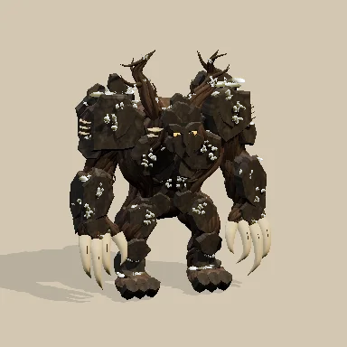

# glb-creator

**Give your coding agent a 3D art department.** glb-creator is an agent skill that builds textured, rigged, animated GLB assets in pure TypeScript — no Blender, no DCC app, no image round-trips — and shows the agent every revision as a single labeled contact sheet.


*Same task, same model, same reference. The right-hand monster was built **3.4× faster** using **27% fewer tokens** — and scored higher on visual quality.*



## Why this exists

When a coding agent authors 3D assets through Blender's headless CLI, every iteration costs a process launch, a Python script, a render to disk, and a pile of log output. The agent spends most of its tokens on plumbing instead of art.

glb-creator collapses the whole loop into **one command**:

```sh
bun run dev -- tmp/creature.ts
```

That single call:

1. **Builds** the asset from a small TypeScript recipe (ellipsoids, tapered tubes, fractured plates, raw triangles — each bound to a skeleton joint).
2. **Validates** it with the Khronos glTF validator.
3. **Measures** it — triangles, height, grounding, materials, clips — into one compact JSON line.
4. **Renders** a labeled 6-view contact sheet (front / left / back + three animation phases) as one image.

The agent reads one image and one JSON line per revision. That's the entire feedback loop.

## The benchmark

We gave the identical brief to 4 parallel Claude (sonnet) agents per pipeline: *recreate this forest-warden concept art as a grounded, textured, skinned GLB with a 1.2 s attack animation*, using the same prepared PBR texture sets. One arm used Blender 5.2 headless CLI; the others used successive versions of this skill. Every one of the 16 runs delivered a valid GLB with 0 Khronos errors.

| | Blender CLI | glb-creator (final) | delta |
|---|---:|---:|---:|
| Tokens per asset (mean) | 112,034 | **82,081** | **−27%** |
| Wall-clock per asset (mean) | 5.6 min | **1.65 min** | **3.4× faster** |
| Tool calls per asset (mean) | 24.8 | **14.3** | −42% |
| Visual quality vs reference (mean, /10) | 4.5 | **6.5** | +2.0 |
| Khronos errors | 0 | 0 | — |

### Time


### Tokens


### Quality


The intermediate bars tell the optimization story: **v2** introduced the one-shot `dev` command and the contact sheet; **v3** added numeric dimension reporting, `scale()`, and a pitfalls guide distilled from watching agents work (that's where tool calls dropped from ~22 to ~13 — agents stopped writing their own measuring scripts); **v4** made `tube()` radii forgiving and tightened the quality guidance. Notice the consistency too: the final skill's four runs landed within a 2k-token band (81.2k–83.0k), while Blender runs spread across 23k.

<details>
<summary>Methodology and caveats</summary>

- 4 subagents per arm ran in parallel on one Windows 11 machine (Ryzen 9 9950X3D, RTX 5090, Bun 1.4.4, Blender 5.2), all on claude-sonnet-5-5, October 2026.
- Token counts and durations come from the agent harness telemetry for each subagent.
- Every delivered GLB was re-rendered with the same renderer, camera, and lighting into a uniform contact sheet; visual scores are a single reviewer's judgment of likeness to the reference, materials, grounding, and animation.
- Caveats: one task, one host, different renderers between authoring pipelines, and model nondeterminism across runs. Raw per-run data and all 16 deliverables live in the [claude demo repository](https://github.com/asilvas/skill-glb-creator-claude-demo).
</details>

## Install

```sh
npx skills add https://github.com/asilvas/skill-glb-creator
```

Then from the installed skill folder:

```sh
bun run setup
```

[Bun](https://bun.com/) ≥ 1.4.4 is required. Blender is not. Tested on Windows; the native renderer needs verification on other hosts.

## Use

Everything an agent (or you) needs is in [skills/glb-creator/SKILL.md](skills/glb-creator/SKILL.md) — the full authoring API, a complete working recipe, the `dev` command reference, a quality checklist, and the pitfalls list. The short version:

```ts
// tmp/creature.ts
import { Asset } from '../scripts/geometry';

export default async function build() {
  const a = new Asset();
  a.joint('Root', [0, 0, 0]);
  a.joint('ArmL', [-.7, 2, 0], 'Root');
  a.ell('skin', [0, 1.4, 0], [.55, .8, .45], 'Root');                 // torso
  a.tube('skin', [[-.7, 2, 0], [-1.1, .9, .2]], [.18, .1], 'ArmL');   // arm
  a.plate('armor', [0, 1.6, .5], [.45, .5, .14], 'Root', 1);          // stone plate
  const clip = a.doc.createAnimation('attack');
  a.channel(clip, 'ArmL', [0, .3, .5, 1.1], [[0,0,0], [-.9,0,0], [1.1,0,.2], [0,0,0]]);
  return a;
}
```

```sh
bun run dev -- tmp/creature.ts
# → tmp/creature.glb + tmp/creature-sheet.webp + one JSON summary line
```

Textures are supplied inputs (`a.surfaces.set(...)` embeds PBR maps with UVs); image generation is intentionally outside this skill. For many fast frames there's a persistent loopback preview server (`bun run preview -- tmp/creature.glb --serve` with `/asset`, `/frame`, `/sheet`, `/analyze` endpoints). For anything beyond the helpers, `a.doc` exposes the full [glTF Transform](https://gltf-transform.dev/) document.

## What's in the box

| Command | What it does |
|---|---|
| `bun run dev -- <recipe.ts\|asset.glb>` | Build + validate + measure + contact sheet, one JSON summary line |
| `bun run preview -- <glb> [--serve]` | Render frames, or start the persistent preview server |
| `bun run frame -- <time> [yaw] [size]` | One frame from the running server |
| `bun run test` / `bun run check` | Library self-tests and skill lint |
| `bun run clean` | Preview/apply scratch cleanup (`tmp/` auto-expires after 7 days) |

Bun programs can also consume the library directly: `@asilvas/glb-creator` exposes `/geometry`, `/preview`, and `/validate`.

Limitations: convenience shapes bind rigidly to one joint (blended weights need the glTF Transform document directly), the preview plays the first animation clip only, and custom shader hooks are rejected by the native renderer. Always verify your target engine's import rules.

[MIT license](LICENSE).
