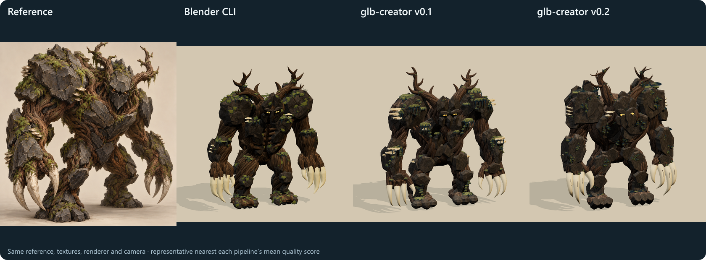
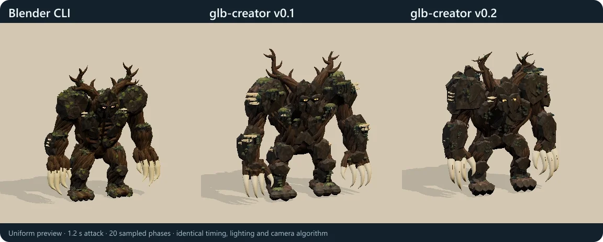
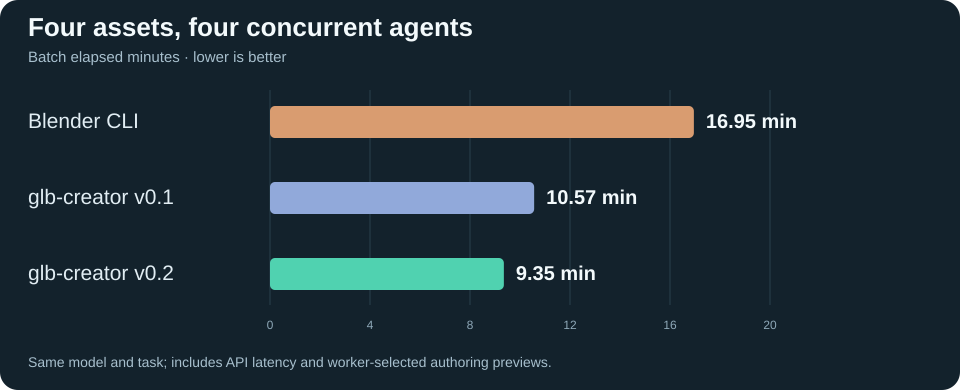
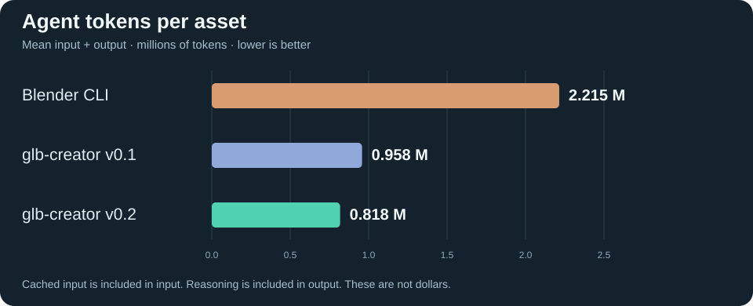
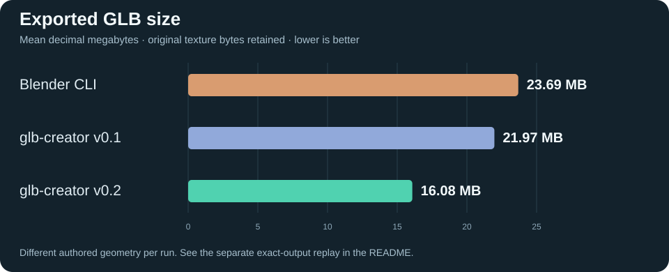
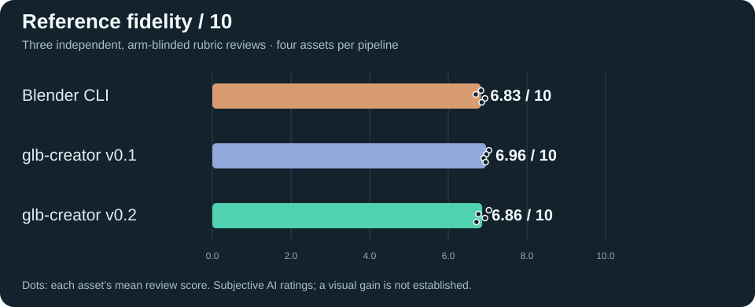

# glb-creator

**Give your coding agent a 3D art department.** Build textured, rigged, animated GLB assets with Bun and TypeScript. One command builds, validates, measures, and renders a labeled contact sheet for the next revision.



**v0.2 builds the same recipe 1.51× faster and exports a 4.51% smaller GLB, with identical decoded triangle attributes and pixel-identical renders at all five tested animation times.** In the separate four-agent authoring experiment, v0.2 used 14.6% fewer total tokens and produced 26.8% smaller files than v0.1. Visual quality remained close; an improvement is not established.



*Representative selection: the asset nearest each pipeline's mean quality score, with ties broken by run name. All twelve results are available in the [complete gallery](media/all-runs.png). Individual clips: [Blender CLI](media/blender-attack.webp), [glb-creator v0.1](media/v0.1-attack.webp), [glb-creator v0.2](media/v0.2-attack.webp).*

## One command per revision

```sh
bun run dev -- tmp/creature.ts
```

The command builds the recipe, runs the Khronos glTF validator, reports dimensions and asset statistics as one JSON line, and renders a six-view sheet: front, left, back, and three animation phases. Requested previews that fail or produce blank tiles make the command fail, so a valid file cannot silently substitute for a usable visual check.

Geometry helpers cover ellipsoids, tapered tubes, curved strands, fractured plates, and raw triangles. Helpers bind shapes to skeleton joints; animation channels add anticipation, impact, and recovery. Supplied PBR images are embedded without changing their bytes.

## What's new in v0.2

Claude created **glb-creator v0.1**, including the one-command workflow and contact sheets. **glb-creator v0.2** adds the optimizations developed and tested in the [Codex demo](https://github.com/asilvas/skill-glb-creator-codex-demo):

- Smooth meshes retain their indices during construction. Exact rigid weights use normalized bytes; joint indices use bytes through 256 joints, then unsigned shorts. This reduces allocation and export size without lossy texture or geometry compression.
- `loadSurfaces()` reads a PBR manifest with optional material aliases. `curve()` builds tapered Catmull–Rom strands. Ellipsoids accept rotation and optional tessellation for small accents.
- Grounding handles geometry above or below zero and ignores unreferenced source vertices. Requested preview failures propagate through `dev`.
- Shorter skill instructions explain the complete API, path handling, material masks, shape layering, and visual iteration. Fifteen library tests cover the original workflow and new behavior.

Existing helper defaults and dependency versions are retained. The same-recipe replay below isolates the library changes from different authoring choices.

## Controlled authoring comparison

Each pipeline received the identical prompt, reference, and prepared PBR texture bytes. **Four independent agents ran concurrently in every pipeline**, for twelve deliverables. All twelve used the same configured Codex model and reasoning effort (`gpt-6.1-sol`, `xhigh`); the v0.1 label credits the skill's author, not a different model in this experiment.

| Measure | Blender CLI | glb-creator v0.1 | glb-creator v0.2 |
|---|---:|---:|---:|
| Four-asset batch elapsed | 16.95 min | 10.57 min | **9.35 min** |
| Mean elapsed per worker | 14.28 min | **8.19 min** | 8.39 min |
| Mean total tokens¹ | 2,214,767 | 957,793 | **818,054** |
| Mean output tokens | 45,307 | **27,946** | 30,509 |
| Mean GLB size² | 23.69 MB | 21.97 MB | **16.08 MB** |
| Mean reference quality³ | 6.83 / 10 | 6.96 / 10 | 6.86 / 10 |
| Delivered / Khronos-valid | 4 / 3 | 4 / 4 | 4 / 4 |

¹ Input + output. Cached input is already included in input; reasoning is already included in output. These counts are not dollar costs. ² Decimal MB, with original PBR bytes embedded. ³ Three independent, arm-blinded AI rubric reviews; ratings are subjective.

### Time under load



v0.2 completed the four-asset batch **11.5% sooner than v0.1**. Its mean individual worker took **2.5% longer**. Batch completion depends on the slowest worker; this small experiment does not establish a general per-task speedup.

### Token use



v0.2 used **14.6% fewer total tokens than v0.1**, while output tokens increased **9.2%**. Most input was cached. Dollar savings depend on the applicable input, cached-input, and output prices; parent development and review costs were excluded and unmetered.

### File size



The v0.2 authoring runs produced **26.8% smaller mean files than v0.1**, with different geometry generated by each worker. The same-recipe replay isolates a **4.51%** size reduction from the library itself.

### Reference fidelity



Mean scores were **6.83, 6.96, and 6.86 / 10**. v0.2's score was 0.10 below v0.1. The rubric allocates 3 points to silhouette/proportions, 3 to material/shape integration, 2 to focal details, and 2 to animation/grounding. Inspect the [all-run gallery](media/all-runs.png) alongside the scores; human review takes precedence.

### Same-recipe replay

Seven alternating fresh-process builds per skill used the same recipe, images, geometry, and animation. Median build/export/write time fell from **162.8 ms to 108.0 ms (1.51× faster)**. File size fell from **8,624,064 to 8,235,352 bytes (4.51% smaller)**. Decoded triangle attributes had a maximum difference of zero. Renders at 0, 0.36, 0.66, 1.02, and 1.2 seconds were pixel-identical at 384 px. This compares v0.1 and v0.2; it is separate from agent authoring time.

<details>
<summary>Evidence, method, and limitations</summary>

- The [media evidence bundle](media/benchmark.json) contains all twelve run summaries, token categories, timing, size, validity, quality, representative selection, replay trials, and SHA-256 hashes of the source evidence, promoted skill files, and media. The full protocol, raw telemetry, recipes, GLBs, contact sheets, and individual reviews live in the [Codex demo repository](https://github.com/asilvas/skill-glb-creator-codex-demo), under `results/experiment/` and `runs/`.
- Input hashing verified the same task, reference, and all 26 supplied texture/manifest files across the twelve runs. Each pipeline's four workers overlapped. Dependencies were preinstalled, and each worker had the same four-attempt build/render budget. Failed validation remains in the denominator: Blender's second asset had 81 tangent errors.
- Every final GLB was imported into the same evaluation renderer with the same lighting, camera algorithm, resolution, and animation times. Reviewers saw anonymous IDs and did not receive pipeline identities or performance results.
- Authoring previews differed. All four Blender workers chose CPU Cycles with 24–64 samples and four threads; the skill used its native raster renderer. Timing includes API latency and these choices, so this is not a fastest-possible Blender runtime comparison.
- Measured on one Windows host with a Ryzen 9 9950X3D and Bun 1.4.4, October 2026. One creature task, four runs per pipeline, fixed pipeline order, possible host load, model variance, caching, and correlated AI reviewer preferences limit generalization. No confidence claim or dollar-cost percentage is inferred.
- The [earlier Claude demo](https://github.com/asilvas/skill-glb-creator-claude-demo) established v0.1. Its historical model, harness, timings, and scores differ; those numbers are not mixed into these graphs. The previous development-stage skill names are consolidated here as v0.1.

</details>

## Install

```sh
npx skills add https://github.com/asilvas/skill-glb-creator
```

Then, from the installed skill folder:

```sh
bun run setup
```

[Bun](https://bun.com/) ≥ 1.4.4 is required. Tested on Windows; the native renderer needs verification on other hosts.

## Use

[skills/glb-creator/SKILL.md](skills/glb-creator/SKILL.md) contains the complete API and working recipe. Save this minimal example as `tmp/creature.ts` inside the installed skill folder:

```ts
import { Asset } from '../scripts/geometry';

export default async function build() {
  const a = new Asset();
  a.joint('Root', [0, 0, 0]);
  a.joint('ArmL', [-.7, 2, 0], 'Root');
  // Optionally load prepared images, relative to their manifest:
  // await a.loadSurfaces('/absolute/textures/materials.json',
  //   {wood: 'bark', basalt: 'stone'});
  a.ell('wood', [0, 1.4, 0], [.55, .8, .45], 'Root');
  a.curve('wood', [[-.5, 2, 0], [-.9, 1.6, .1], [-1.1, .9, .2]],
    [.18, .1], 'ArmL');
  a.plate('basalt', [0, 1.6, .5], [.45, .5, .14], 'Root', 1);
  const clip = a.doc.createAnimation('attack');
  a.channel(clip, 'ArmL', [0, .3, .55, 1.2],
    [[0,0,0], [-.9,0,0], [1.1,0,.2], [0,0,0]]);
  return a;
}
```

```sh
bun run dev -- tmp/creature.ts
# Writes the GLB, a contact sheet, and one JSON summary line.
```

Recipe paths resolve from the installed skill folder. Set `GLB_CREATOR_TMP` to isolate job output and `GLB_CREATOR_CLEANUP=off` to retain scratch artifacts. Copy final deliverables out of scratch before its seven-day expiry. Textures are supplied inputs; `loadSurfaces()` or `surfaces.set()` embeds PBR maps. For advanced geometry, `a.doc` exposes the [glTF Transform](https://gltf-transform.dev/) document.

## Commands

| Command | Purpose |
|---|---|
| `bun run dev -- <recipe.ts\|asset.glb>` | Build, validate, measure, and render a contact sheet |
| `bun run dev -- <asset.glb> --no-sheet` | Intentional validation-only inspection |
| `bun run preview -- <glb> [--serve]` | Render frames or start the loopback preview server |
| `bun run frame -- <time> [yaw] [size]` | Request a frame from the preview server |
| `bun run test` / `bun run check` | Library tests and skill metadata checks |
| `bun run clean` | Inspect or apply scratch cleanup |

Bun programs can import `@asilvas/glb-creator`, including its `/geometry`, `/preview`, and `/validate` entry points. Convenience shapes bind rigidly to one joint; blended weights need the underlying document API. The preview plays the first animation clip, and the native renderer rejects custom shader hooks. Verify your target engine's import rules separately from Khronos validity.

[MIT license](LICENSE).
